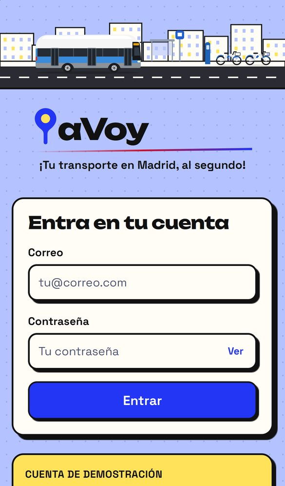
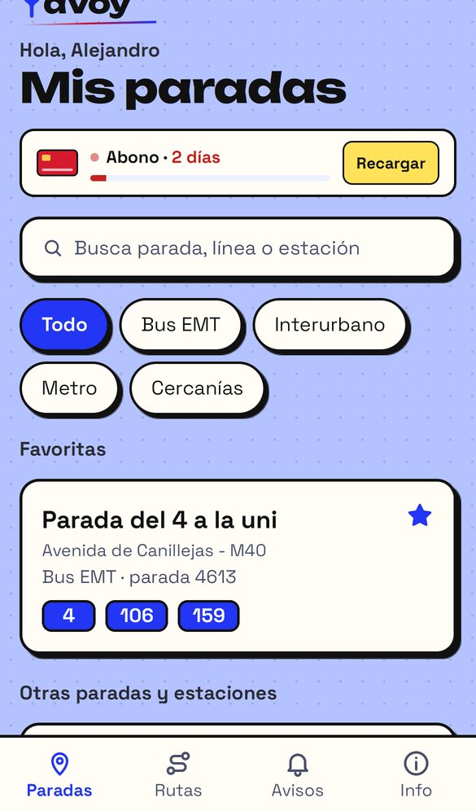
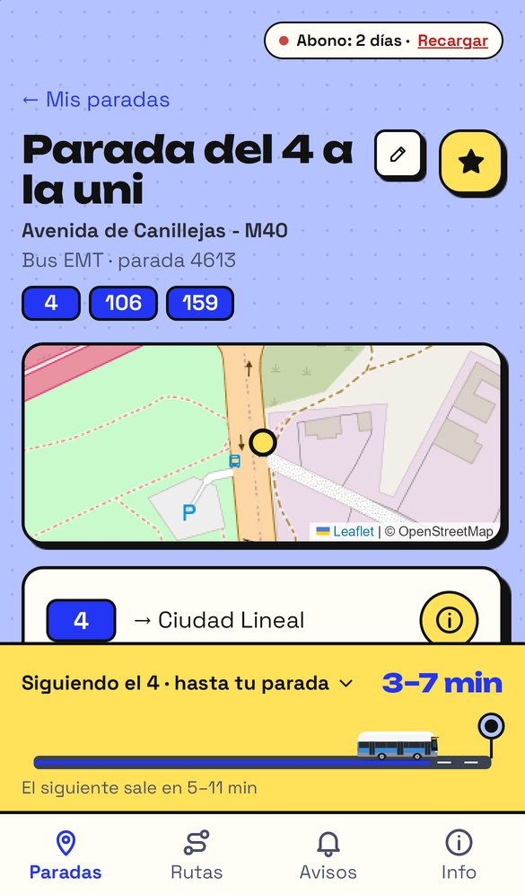
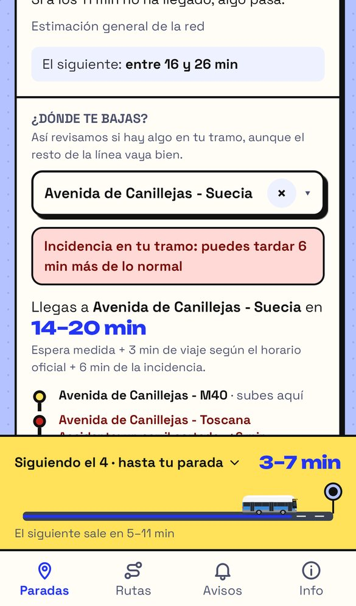
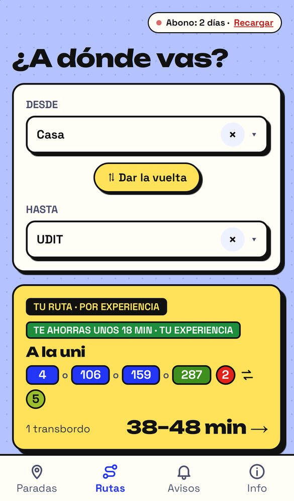
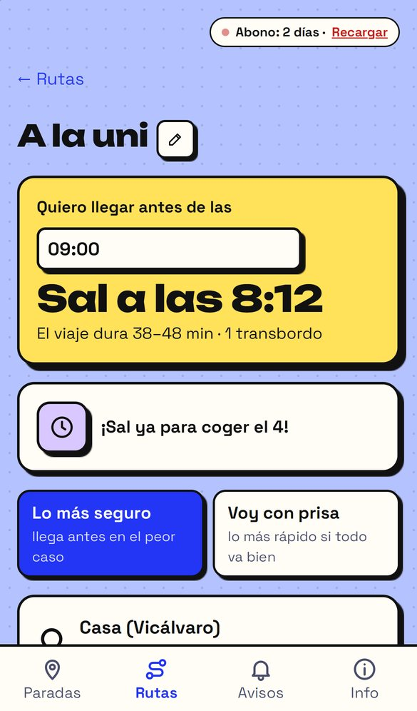

# YaVoy · la web app de la demo

**¡Tu transporte en Madrid, al segundo!** YaVoy no sustituye a las apps oficiales: les añade **cuánto fiarse** de lo que anuncian. Cuando la app dice «12 min», YaVoy te dice «llega entre 10 y 15 min» con los datos que hemos medido nosotros, y a partir de ahí te ayuda a decidir cuándo salir, qué línea coger y dónde ponerte.

Es una web app para móvil (se abre con un QR, sin instalar nada) hecha con **React 18 + Vite 6 + Tailwind 4**, sin servidor: todo lo que necesita está en ficheros estáticos.

| | | |
| --- | --- | --- |
|  |  |  |
|  |  |  |

## Probarla

```
cd web
npm install
npm run dev        # http://localhost:5173
npm test           # casos de «Comprobación» del manual
npm run build      # web estática en web/dist
```

- **Cuenta de demostración:** `demo@yavoy.app` / `yavoy2026` (también hay un botón que la rellena).
- `?hora=8:15&dia=laborable` fija la hora y el tipo de día de la consulta, para ensayar el pitch siempre igual.
- `?rapido` hace que cada minuto de la demo dure 5 s (para ver avanzar el bus).
- **Publicar en Vercel:** carpeta raíz `web`, sin más configuración.

## Qué hace

### Paradas
- **Portada:** saludo, el **abono transporte** en una línea (días que quedan, barrita de 30 días y aviso discreto si quedan menos de 3), buscador, filtros por modo y la escena de cabecera, que cambia con el filtro (bus EMT, interurbano verde, metro, Cercanías).
- **Parada al estilo de la app de la EMT:** todas las líneas que pasan, la siguiente llegada con su **ventana** («llega entre 3 y 7 min») y su fiabilidad («Fiable», «Con margen», «Poco fiable»), la de después, y un aviso de **posible incidencia** cuando los datos dicen que a esa hora la línea acierta menos de 5 de cada 10 veces.
- **¿Dónde te bajas?** Buscador de paradas (escribes «s» y salen Sevilla, Sol…). Se pregunta para revisar **solo tu tramo**: si hay una incidencia entre donde subes y donde bajas, te avisa y suma el retraso; si está más adelante, te dice que no te afecta. Dibuja el tramo parada a parada y te puede **avisar una parada antes de bajar**.
- **Nombres propios:** cada parada y cada ruta se pueden renombrar («Parada del 4 a la uni»); el nombre real sigue debajo en pequeño.
- **Lo que conviene saber de la línea** (botón «i»): rarezas de la línea, tablero de 10 casillas («de cada 10 veces que dijo 12 min…») y los datos completos.

### Rutas
- **¿A dónde vas?** Desde / Hasta con buscador. Te enseña **tu ruta** (la de tu experiencia) frente a **la que te daría un planificador**, con los minutos que te ahorras.
- **Dentro de una ruta:** «Quiero llegar antes de las 9:00 → Sal a las 8:12», «sal de casa en N min para coger el 4», modo **Lo más seguro / Voy con prisa**, todas las opciones de cada tramo con su ventana (la mejor marcada), transbordos, **vagón recomendado** en cada tramo de metro y Cercanías (se toca para cambiarlo), incidencias en tu tramo y aviso antes de bajar.
- **Rutas guardadas:** A la uni, De la uni a casa, Al trabajo (prácticas) y A casa de la abuela, más el caso real medido de «¿Cuándo salgo?» (Móstoles → Nuevos Ministerios).

### Avisos
- Avisos de viajeros **simulados** (y marcados como tal): tipo, línea, cuántos lo confirman, «Sigue pasando» / «Ya no» y un botón para avisar.

### Info
- Cómo funciona, periodo de los datos, fuentes y licencias, límites del método y cerrar sesión.

## De dónde sale cada dato

| Dato | Fuente | ¿Real? |
| --- | --- | --- |
| Ventanas, fiabilidad, tablero de 10 | `demo/fiabilidad.json` + `demo/consultar.js` (datos del 24/09 al 22/11) | **Sí**, medido |
| Paradas, líneas, paradas siguientes y minutos de viaje del bus, metro e interurbano | GTFS oficiales de `datos/horarios_oficiales/` | **Sí**, horario oficial |
| Recorrido de Cercanías Vicálvaro → Atocha | Aproximado | Aproximado (se indica) |
| Minutos «que dice la app oficial» | `public/datos/demo.json` | Demostración (no hay tiempo real conectado) |
| Avisos de viajeros e incidencias | `public/datos/demo.json` | **Simulación** (se indica) |
| Ruta del planificador | `public/datos/demo.json` | Ejemplo |
| Ahorro «unos 18 min» | Experiencia del usuario | Lo dice él, se indica |

`fiabilidad.json` y `consultar.js` **no se copian a mano**: `copiar-datos.mjs` los copia de `../demo` al hacer `dev`, `build` o `test`, así siempre coinciden con los del repo de datos.

## Cómo está hecho

```
web/
├── public/datos/demo.json       paradas, rutas, incidencias, avisos y abono de la demo
├── public/logo/                 icono de YaVoy
├── src/App.jsx                  navegación, sesión, favoritas, nombres, abono, seguimiento
├── src/lib/
│   ├── consultar.js             (copiado de ../demo) consulta de fiabilidad
│   ├── ventana.js               ventana, nivel de fiabilidad, tablero (copiado del manual)
│   ├── rutas.js                 cálculo de rutas, mejor opción, hora de salida, incidencias del tramo
│   └── util.js                  textos, fechas y llegadas
├── src/pantallas/               Login, Paradas, Parada, LineaInfo, Rutas, CuandoSalgo, Prometido, Avisos, Info
└── src/componentes/             Combo (desplegable con buscador), Vagones, Abono, Escena, Vehiculos,
                                 FranjaSeguimiento, Logo, BarraInferior, Iconos, Comunes
```

- **Diseño:** estilo neobrutalista (fondo lavanda con cuadrícula de puntos, tarjetas crema con borde negro y sombra sólida, amarillo para lo destacado). Letras **Unbounded** (títulos y cifras) y **Space Grotesk** (texto), incluidas en la web.
- **Dibujos:** los vehículos (bus EMT, interurbano, Cercanías, metro serie 5000 y BiciMAD) son SVG propios, sin logotipos de operadores.
- **Datos del navegador:** sesión, favoritas, nombres, vagones y abono se guardan en `localStorage`; si no hay almacenamiento, la app funciona igual.
- **Accesibilidad:** todo lo tocable mide 44 px o más, la fiabilidad siempre va con texto además de color, y con «reducir movimiento» no hay animaciones.

## Comprobado

- `npm test`: 8 pruebas con los casos de «Comprobación» del manual.
- Recorridos automáticos en **WebKit** (el motor de Safari) en iPhone SE, 13, 15 Pro Max y en horizontal: sin errores ni scroll horizontal.
- Sin probar todavía en un iPhone real.

## Pendiente

- Publicarla (Vercel) y el QR.
- Probarla en un iPhone real.
- Más paradas interurbanas medidas (ahora solo el 691).
